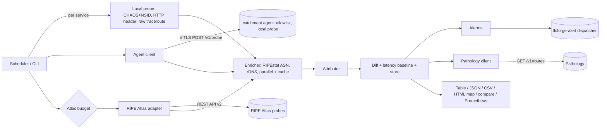

# Catchment Architecture

Anycast prober. Runs traceroutes from vantage points worldwide and maps which PoP the traffic actually lands in.

This document describes how Catchment is put together, where its trust boundaries are and how it behaves when things go wrong. It is the starting point for contributors; keep it up to date when you change the design.

## Design principles

- **Self-hosted, single binary.** No SaaS dependency, no external database. State lives in a local data directory: one JSON file per round, the alert queue, silences and the Atlas budget ledger.
- **Fail safe and loud.** Missing or stale input is reported as such; silence is never treated as "all clear". Results that match no rule are `unattributed`, never guessed.
- **Untrusted input everywhere.** DNS answers, ICMP replies, HTTP headers, RIPE Atlas results, RIPEstat, agent and Pathology responses are parsed defensively with explicit size limits. No `unsafe` code.
- **Secrets from the environment.** API keys and tokens are read from environment variables named in the config, never from the file or logs.
- **Alerts are never delayed.** Cross-tool calls (Pathology) run after the alerts of a round were handed to the dispatcher, are time-boxed and optional.
- **Observable.** Prometheus metrics, `/healthz` / `/readyz`, structured text or JSON logs on stderr.

## Data flow



## Components

| Component | Module | Responsibility |
|---|---|---|
| **CLI, daemon, reload** | `src/main.rs` | `probe`, `fetch`, `show`, `compare`, `run`, `agent`, `silence`, `service`; daemon loop per `[schedule] interval` across all services; config reload (SIGHUP / file / API); one admin listener (`/metrics`, `/healthz`, `/readyz`, `/v1/silences`, `/v1/reload`). |
| **Config** | `src/config.rs` | TOML parsing (unknown keys rejected), startup validation, normalisation of `[target]` and `[[service]]` into `Service` values. |
| **Probe** | `src/probe.rs` | One local measurement (CHAOS TXT + NSID, HTTP header, traceroute) run concurrently; shared by the local vantage and the agent. |
| **DNS codec and client** | `src/dns.rs` | Hand-written query encoder (optional EDNS OPT with NSID) and bounds-checked response parser (TXT, PTR, OPT, compression pointers); UDP client with retries and id checking. |
| **Traceroute** | `src/traceroute.rs` | ICMP / UDP / TCP probes with increasing TTL / hop limit via `socket2`; replies read from a raw ICMP(v6) socket and matched against the quoted probe; privilege errors mapped to per-OS guidance. |
| **HTTP identification** | `src/http_id.rs` | `GET` to the target address with the URL host as SNI/Host, no redirects, no proxy, body never read; returns the configured header. |
| **Agent** | `src/agent.rs` | Server: rustls with `WebPkiClientVerifier` (client certificates required), handshake tasks bounded and time-limited, 16 KiB request limit, local allowlist, concurrency limit. Client: reqwest with a private root and client identity, response size limit, output re-sanitised. |
| **RIPE Atlas adapter** | `src/atlas.rs` | One-off DNS CHAOS (optional `set_nsid_bit`), IPv6 run from the same probes (`msm` selection), ICMP traceroutes, status polling, results, probe metadata (country, ASN, location), account balance. |
| **Budget** | `src/budget.rs` | Daily / monthly credit caps, worst-case booking in `atlas-budget.json` (atomic writes), UTC period rollover. |
| **Enricher** | `src/enrich.rs` | Last-hop ASN (RIPEstat `network-info`) and reverse DNS for observations not identified by the server itself, only when a rule needs them; bounded parallelism and a TTL cache shared across rounds. |
| **Attributor** | `src/attribute.rs` | `[[pop]]` rules: CHAOS, NSID, HTTP globs, then last-hop ASN, prefix, rDNS regex. |
| **Diff, aggregation** | `src/diff.rs`, `src/aggregate.rs` | Shifts per (vantage, address); per-country, per-ASN, dual-stack and before/after comparison. |
| **Alarms** | `src/alarms.rs` | `catchment_shift`, `catchment_shift_paths`, `latency_regression` (with resolve) alerts. |
| **Pathology client** | `src/pathology.rs` | `GET /v1/routes?prefix=&since=&limit=` with optional bearer token, time-boxed, 4 MiB limit. |
| **Store** | `src/store.rs` | Atomic round files (`round-<ms>.json`), retention, recent rounds, lookup by experiment label. |
| **Exporters** | `src/output.rs`, `src/map.js`, `src/metrics.rs` | Table, JSON, CSV, HTML report with the bundled map (`assets/map/`), compare table; Prometheus text format. |
| **Pipeline** | `src/pipeline.rs` | One round of one service: collect (local, agents, Atlas in parallel), enrich, attribute, diff, alarms, correlate, persist. |
| **Shared plumbing** | `crates/llcforge-alert` | Vendored suite crate: alert schema, sinks, queue, silences, health, reload, logging, service integration. |

## Trust boundaries

- **RIPE Atlas / RIPEstat:** the API key is only sent to the configured `https://` Atlas base URL; the shared client refuses plain HTTP. Responses are size-capped (64 MiB / 1 MiB).
- **Measurement data** (CHAOS TXT, NSID, HTTP header values, reverse DNS, Atlas JSON, agent output) is attacker-influenced. Text is stripped of control characters and capped at 255 characters at decode time; NSID that is not printable is shown as hex.
- **Raw sockets:** only replies quoting one of our own probes (destination, ports or ICMP id/sequence) are counted; buffers are fixed-size and every offset is checked.
- **Agents:** mutual TLS with a dedicated CA; the agent independently enforces its `allowed_targets`, qname validity, HTTP URL rules (DNS name only, no credentials) and whether traceroute is allowed, so the controller cannot make it probe anything else. Unauthenticated TCP clients never reach HTTP parsing.
- **Admin listener:** `/metrics`, `/healthz`, `/readyz` are unauthenticated and read-only (bind to loopback or a management network); `/v1/silences` and `POST /v1/reload` require bearer tokens from environment variables (constant-time comparison).
- **Pathology:** plain `http://` is accepted only for loopback hosts; responses are bounded, sanitised and never block alerts.
- **HTML report:** every value is HTML-escaped; embedded JSON escapes `<`, `>` and `&`; the CSP allows exactly the four embedded scripts by SHA-256 and nothing remote.
- **CSV:** cells starting with `= + - @` are prefixed with `'`.

## Failure modes

| Situation | Behaviour |
|---|---|
| Atlas credits exhausted / rate limited / budget cap | The Atlas part of the round is skipped with a warning (and an `atlas_budget` alert for caps); local and agent vantages still report. |
| `min_balance` set but balance unreadable | Atlas skipped for that round (fail closed). |
| Atlas measurement not finished within `wait` | Partial results are fetched and used. |
| Agent unreachable / refuses / TLS failure | That vantage reports an `agent: ...` error; the round continues. |
| No raw-socket privilege / ICMP blocked | `trace_error` on the observation, warning in the log; CHAOS/NSID/HTTP result kept. |
| PoP identifier missing | Falls back to last-hop rules; still-unknown results are `unattributed`. |
| Previous rounds unreadable | Warning; shift detection and latency baseline skipped for that round. |
| Pathology slow or down | Correlation reports the error after the timeout; alerts were already sent. |
| Alert sink down | llcforge-alert keeps alerts in the persistent queue and redelivers. |
| Invalid configuration on reload | Logged; the running configuration stays active. |
| Round produces no observations | Round fails; counted in `catchment_rounds_total{outcome="failed"}`. |

## Runtime model

- Tokio runtime. Every interval tick runs one round per service concurrently; within a round local, agent and Atlas collection run concurrently, enrichment uses a semaphore-bounded task set.
- A reload rebuilds services, agents and the alert dispatcher; the next round starts one interval after the reload, so a reload never triggers an extra (credit-consuming) round.
- Graceful shutdown on Ctrl+C / `SIGTERM` / Windows service stop: an in-flight round is abandoned (not saved), the dispatcher drains for up to 5 s, the listener stops. Round files, ledger and silences are written atomically.

## Repository layout

```
Catchment/
├── .github/workflows/         CI (Linux, Windows, macOS), release, dependabot
├── assets/                    logos, icons, README visuals
├── assets/map/                bundled d3-array, d3-geo, topojson-client, world-atlas (ISC)
├── crates/llcforge-alert/     vendored shared crate (sync.py)
├── deploy/                    Grafana dashboard, Prometheus rules, Helm chart
├── packaging/                 deb/rpm fragment, systemd, launchd, Windows service, Homebrew, scoop, winget
├── src/
│   ├── main.rs                CLI, daemon, reload, admin listener
│   ├── config.rs              config parsing and validation
│   ├── pipeline.rs            one measurement round
│   ├── probe.rs               local measurement (shared with the agent)
│   ├── dns.rs                 DNS codec (TXT, PTR, OPT/NSID) and UDP client
│   ├── traceroute.rs          raw-socket traceroute
│   ├── http_id.rs             HTTP header identification
│   ├── agent.rs               mTLS agent server and client
│   ├── atlas.rs               RIPE Atlas REST API v2 adapter
│   ├── budget.rs              Atlas credit budget
│   ├── enrich.rs              RIPEstat ASN and reverse DNS lookups with cache
│   ├── attribute.rs           PoP rules
│   ├── diff.rs                shift detection
│   ├── aggregate.rs           per-ASN, per-country, dual-stack, compare
│   ├── alarms.rs              alert construction and latency tracking
│   ├── pathology.rs           Pathology client
│   ├── store.rs               round persistence
│   ├── output.rs, map.js      table / JSON / CSV / HTML map / compare
│   ├── metrics.rs             Prometheus exposition
│   └── model.rs               shared data types
├── tests/fixtures/            hand-written RIPE Atlas result fixtures
├── catchment.example.toml     annotated controller configuration
├── catchment-agent.example.toml  annotated agent configuration
├── ARCHITECTURE.md            this file
├── README.md                  English documentation
└── README.tr.md               Turkish documentation
```

## Roadmap

See the "Roadmap" section of [README.md](README.md) for the known limits (HTTP identification on Atlas, Paris-traceroute, agent service units, budget reconciliation, persistent regression state).

## Related tools

- [Pathology](https://github.com/LLCForge/Pathology): BGP route monitor for your own routers and BMP feeds. Learns the AS paths and origins your prefixes normally use, then alerts on any deviation.
- [Event Horizon](https://github.com/LLCForge/Event-Horizon): Automated RTBH in Rust. On DDoS detection it announces the victim prefix as a blackhole and sends the BGP community upstream.
- [Notary](https://github.com/LLCForge/Notary): RPKI Route Origin Validation checker. Tells you whether your prefixes are RPKI-valid and watches third-party ASes, in milliseconds.
