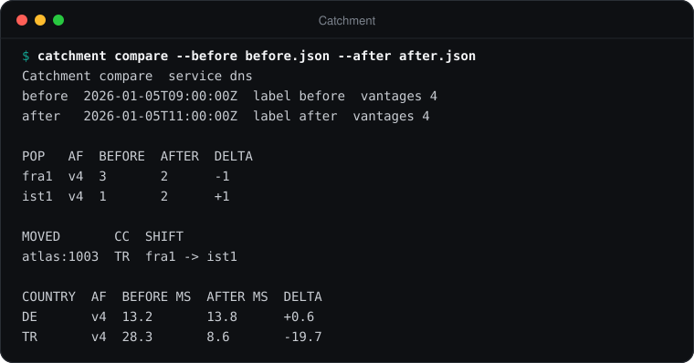
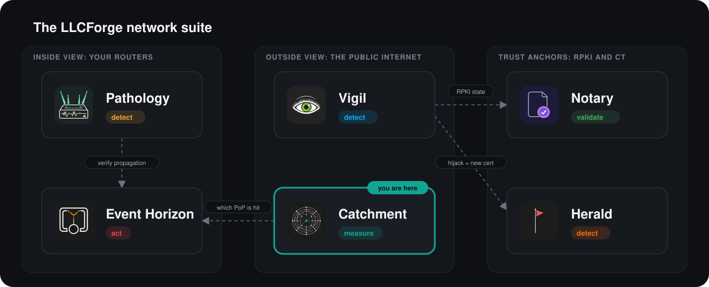

> **LLCForge network tooling** — self-hosted, Rust, no SaaS.
> [Pathology](https://github.com/LLCForge/Pathology) · [Event Horizon](https://github.com/LLCForge/Event-Horizon) · **Catchment** · [Notary](https://github.com/LLCForge/Notary) · [Herald](https://github.com/LLCForge/Herald) · [Vigil](https://github.com/LLCForge/Vigil)

<!-- readme-visuals -->
<p align="center">
  
</p>

<p align="center">Anycast prober. Runs traceroutes from vantage points worldwide and maps which PoP the traffic actually lands in.</p>

<p align="center">
  <strong>English</strong> · <a href="README.tr.md">Türkçe</a>
</p>

<p align="center">
  <a href="LICENSE"></a>
  
  
</p>

---

## Why

With anycast, BGP decides which site serves each user, not you. A single upstream change can silently shift a whole continent to the wrong PoP, doubling latency or concentrating an attack on one site. Catchment measures the catchment continuously from the outside so you see those shifts as they happen.

## Demo

<p align="center">
  
</p>

<sub>Real output of `catchment compare --before before.json --after after.json` (experiment mode) on sample rounds that use documentation address ranges and private ASNs.</sub>

## Features

- **Vantage points:** RIPE Atlas probes (your own API key and credits, selected per country), the local machine, and self-hosted **agents** (`catchment agent`) reached over **mutual TLS**. Every agent enforces its own local target allowlist. Results of existing Atlas measurements can be reused with `catchment fetch`.
- **PoP identification:** DNS CHAOS TXT (`hostname.bind` / `id.server`), **EDNS NSID** (RFC 5001, also on Atlas), an **HTTP response header** (e.g. `x-served-by`, local and agents), last hop of an Atlas ICMP traceroute, and a **local raw-socket traceroute** (ICMP, UDP or TCP).
- **Attribution:** server identity first (CHAOS glob, NSID glob, HTTP header glob), then last-hop ASN (RIPEstat), last-hop prefix and last-hop reverse-DNS regex. Anything that matches no rule is `unattributed`, never guessed. Last-hop lookups run in parallel (bounded) with a TTL cache shared across rounds.
- **Several anycast services in one config** (`[[service]]`), each with its own target, PoP rules, prefix, data directory and metrics label.
- **IPv6 and dual-stack:** IPv4 or IPv6 targets; with `address6` both families are measured from the same vantages, compared per vantage (same PoP or not, RTT difference) and diffed separately.
- **Change detection and alarms:** every round is saved (atomic writes, bounded retention) and compared with the previous one. Shifts are aggregated per country and sent as `catchment_shift` alerts; per-country median RTT is compared with a baseline of recent rounds and raises/resolves `latency_regression` alerts. Alerts go through **llcforge-alert**: Telegram, webhook (HMAC), Slack, Discord, Teams, e-mail, PagerDuty, Opsgenie, syslog, stdout; persistent queue, dedup and silences.
- **Pathology correlation:** on a shift, Catchment asks [Pathology](https://github.com/LLCForge/Pathology) which BGP path changes it saw for the service prefix since the previous round and attaches them to the report and a follow-up alert (never delaying the shift alert).
- **RIPE Atlas credit budget:** daily / monthly caps (and an optional minimum balance) checked before any measurement is created; the worst-case cost is booked in a persistent ledger.
- **Experiment mode:** label rounds (`--label before`, `--label after`) and `catchment compare` them: PoP counts, moved vantages, per-country latency.
- **Output:** terminal table (with per-ASN and dual-stack sections), JSON, CSV (formula-injection safe), and a self-contained **HTML report with a world map** (bundled d3-geo + Natural Earth data, no CDN, scripts pinned by CSP hashes). Prometheus metrics, `/healthz`, `/readyz`, JSON or text logs.
- **Operations:** config reload (SIGHUP, file change, `POST /v1/reload`), `catchment silence add|list|remove`, `catchment service install|uninstall|run` (Windows service; systemd / launchd units shipped), packages for Linux, macOS and Windows, container image and Helm chart.

## Where it fits in the suite

Catchment measures *where traffic lands*; [Pathology](https://github.com/LLCForge/Pathology) explains *why* (which upstream path changed). During an attack, Catchment shows which PoP is absorbing it before [Event Horizon](https://github.com/LLCForge/Event-Horizon) is asked to blackhole anything.

<p align="center">
  
</p>

## Installation

Release archives for Linux (glibc and static musl, x86_64 / aarch64), macOS (Apple Silicon / Intel) and Windows (x86_64 / aarch64) are attached to each GitHub release with a cosign-signed `SHA256SUMS`.

**Linux (deb / rpm / systemd)**

```bash
sudo apt install ./catchment_<version>_amd64.deb      # or: sudo dnf install ./catchment-<version>.x86_64.rpm
sudoedit /etc/catchment/catchment.toml                 # the example config is installed here
echo 'RIPE_ATLAS_KEY=...' | sudo tee /etc/catchment/catchment.env && sudo chmod 600 /etc/catchment/catchment.env
sudo systemctl enable --now catchment                  # runs `catchment run --config /etc/catchment/catchment.toml`
sudo systemctl reload catchment                        # SIGHUP: reload the configuration
```

The unit is hardened (`DynamicUser`, no capabilities, state in `/var/lib/catchment`). For the local raw-socket traceroute add `AmbientCapabilities=CAP_NET_RAW` and `CapabilityBoundingSet=CAP_NET_RAW` in a drop-in (`systemctl edit catchment`).

**macOS (Homebrew / launchd)**

```bash
brew install llcforge/tap/catchment
sudo cp packaging/launchd/net.llcforge.catchment.plist /Library/LaunchDaemons/   # from the source tree or release archive
sudo launchctl bootstrap system /Library/LaunchDaemons/net.llcforge.catchment.plist
```

`catchment service install` prints the same steps on macOS and Linux.

**Windows (scoop / winget / service)**

```powershell
scoop install .\catchment.json      # manifest from catchment-<version>-package-manifests.tar.gz (or your bucket)
# or, once the manifest is published to winget-pkgs:
winget install LLCForge.Catchment
# Native Windows service (elevated PowerShell, in the extracted release zip):
.\install-service.ps1 -Config .\catchment.example.toml -EnvFile .\catchment.env
```

See [packaging/windows/README.md](packaging/windows/README.md) for the service account, data directory and secret handling. The service runs as `LocalService`, which cannot open raw sockets: leave `[vantage.local] traceroute = "off"` there.

**Docker**

```bash
docker compose up -d        # uses ./catchment.toml and ./catchment.env, data in a named volume
```

The image is distroless, non-root, read-only. Set `[metrics] listen = "0.0.0.0:9184"` inside containers. The raw-socket traceroute needs `cap_add: [NET_RAW]`.

**Helm**

```bash
helm install catchment deploy/helm/catchment -f my-values.yaml   # put your TOML under `config:`
```

The chart probes `/healthz` and `/readyz` on port 9184, keeps the alert queue and rounds on a PVC and can create a ServiceMonitor. Grafana dashboard and Prometheus rules: `deploy/grafana/`, `deploy/prometheus/`.

**From source**

Requirements: Rust 1.85+ ([rustup.rs](https://rustup.rs)). No system libraries are needed (TLS is rustls).

```bash
git clone https://github.com/LLCForge/Catchment.git
cd Catchment
cargo build --release
```

## Quick start

> **Status:** pre-release. Configuration keys and CLI flags may change before 1.0.

```bash
cp catchment.example.toml catchment.toml   # then edit it
./target/release/catchment --config catchment.toml probe
```

Minimal single-service `catchment.toml` (addresses use documentation ranges, replace with your own). The full annotated multi-service example is [catchment.example.toml](catchment.example.toml).

```toml
[target]
address = "192.0.2.53"
qname = "hostname.bind"      # or "id.server"
nsid = true                  # also ask for EDNS NSID
traceroute = true            # Atlas: enables last-hop rules

[[pop]]
name = "fra1"
match = { chaos = "fra1.*", nsid = "fra1-*" }

[[pop]]
name = "ist1"
match = { chaos = "ist1.*", last_hop_asn = 64511 }

[[pop]]
name = "nyc1"
match = { last_hop_prefix = "198.51.100.0/24" }

[vantage.local]
country = "TR"

[vantage.ripe_atlas]
api_key_env = "RIPE_ATLAS_KEY"
probes = { countries = ["DE", "TR", "US", "BR", "JP"], per_country = 10 }
budget = { daily_credits = 20000, monthly_credits = 400000 }

[schedule]
interval = "15m"

[metrics]
listen = "127.0.0.1:9184"

[[alerts.sink]]
type = "stdout"
```

Several services: replace `[target]` / `[[pop]]` with `[[service]]` tables (`name`, `prefix`, `[service.target]`, `[[service.pop]]`). Rounds of service `x` live in `<storage dir>/x/`.

Other keys: `[vantage.local] asn / lat / lon / timeout / attempts / traceroute / max_hops / trace_port`, `[[vantage.agent]]`, `[vantage.ripe_atlas] wait / poll / base_url / budget`, `[storage] dir / retain`, `[lookup] dns_resolver / concurrency / cache_ttl`, `[alarms]`, `[alarms.latency]`, `[pathology]`, `[logging]`, `[alerts]`, `[silences]`, `[health]`, `data_dir`. The config is validated at startup; unknown keys are rejected. Secrets (API keys, tokens) are always read from environment variables named in the config, never from the file.

## Usage

```bash
# One round from all configured vantages and services, printed and saved
catchment --config catchment.toml probe
catchment --config catchment.toml probe --service dns --format json
catchment --config catchment.toml probe --format csv --html report.html --no-save

# Experiment mode: label rounds around a change, then compare
catchment --config catchment.toml probe --label before
#   ... change prepends / communities / announcements ...
catchment --config catchment.toml probe --label after
catchment --config catchment.toml compare --before before --after after
catchment compare --before round-a.json --after round-b.json --format json

# Attribute existing RIPE Atlas measurements (e.g. a DNS CHAOS and a traceroute id)
catchment --config catchment.toml fetch --measurement 2000001 --measurement 2000002

# Re-render the latest saved round, or a specific round file (with the world map)
catchment --config catchment.toml show --service dns --html report.html
catchment show --round catchment-data/round-00000001794587903000.json --format csv

# Daemon: rounds every [schedule] interval, alerts, /metrics, /healthz, /readyz
catchment --config catchment.toml run --html report.html

# Self-hosted vantage point (on another machine)
catchment --config catchment-agent.toml agent

# Silences and service management
catchment --config catchment.toml silence add --resource 'dns/DE/*' --duration 2h -m "fiber work"
catchment --config catchment.toml silence list
catchment --config catchment.toml service install      # Windows service; prints systemd/launchd steps elsewhere
```

Global flags: `--config`, `--log-format text|json`, `--log-level <level or filter>` (override `[logging]`; `RUST_LOG` also works). Logs go to stderr, data to stdout.

### Alerts

| Kind | When | Resource / id |
|---|---|---|
| `catchment_shift` | `shift_min_vantages` or more vantages of one country moved between the same PoPs | `<service>/<CC>/<v4\|v6>`, id includes `from->to` |
| `catchment_shift_paths` | Pathology reported path changes for the service prefix (info) | `<service>/<prefix>` |
| `latency_regression` | median RTT of a country > baseline × `ratio` and ≥ `min_increase_ms` above it; resolved when it recovers | `<service>/<CC>/<v4\|v6>` |
| `atlas_budget` | a credit cap or `min_balance` stopped the Atlas part of a round | `ripe-atlas` |

Sinks can be routed per service with resource globs, e.g. `resources = ["dns/*"]`.

### Agents (mutual TLS)

An agent serves `POST /v1/probe` over TLS and only accepts clients whose certificate is signed by its configured CA. It only probes addresses in its own `allowed_targets`, so a stolen controller certificate cannot turn agents into a scanner. Example PKI with OpenSSL (use a dedicated CA):

```bash
openssl req -x509 -newkey ec -pkeyopt ec_paramgen_curve:P-256 -nodes -days 825 -subj "/CN=catchment-ca" -keyout ca-key.pem -out ca.pem
openssl req -newkey ec -pkeyopt ec_paramgen_curve:P-256 -nodes -subj "/CN=agent-ams" -keyout agent-key.pem -out agent.csr
printf "subjectAltName=DNS:agent-ams.example.net\nextendedKeyUsage=serverAuth\n" > agent.ext
openssl x509 -req -in agent.csr -CA ca.pem -CAkey ca-key.pem -CAcreateserial -days 825 -extfile agent.ext -out agent.pem
openssl req -newkey ec -pkeyopt ec_paramgen_curve:P-256 -nodes -subj "/CN=controller" -keyout controller-key.pem -out controller.csr
printf "extendedKeyUsage=clientAuth\n" > controller.ext
openssl x509 -req -in controller.csr -CA ca.pem -CAkey ca-key.pem -CAcreateserial -days 825 -extfile controller.ext -out controller.pem
```

Agent side: [catchment-agent.example.toml](catchment-agent.example.toml). Controller side: one `[[vantage.agent]]` per agent with `url`, `ca`, `cert`, `key`.

### Local traceroute privileges

`[vantage.local] traceroute = "icmp" | "udp" | "tcp"` (and `allow_traceroute` on agents) uses raw sockets:

| OS | Requirement |
|---|---|
| Linux | `CAP_NET_RAW` (`setcap cap_net_raw+ep`, systemd `AmbientCapabilities=CAP_NET_RAW`, container `NET_RAW`) or root |
| macOS | root |
| Windows | elevated process (Administrator); inbound ICMPv4/ICMPv6 *Time Exceeded* must be allowed in Windows Firewall |

Without the privilege the traceroute is skipped with a clear `trace_error` and a warning; the CHAOS / NSID / HTTP result of the vantage is kept. If no hop answers at all, `trace_error` says so (typically a firewall dropping ICMP).

### Metrics

`catchment run` with `[metrics] listen` serves `/metrics`, `/healthz`, `/readyz` (plus `/v1/silences` and `POST /v1/reload` when their tokens are configured):
`catchment_rounds_total{service,outcome}`, `catchment_shifts_total{service}`, `catchment_round_shifts{service}`, `catchment_vantages{service,pop,country,family}`, `catchment_country_rtt_median_ms{service,country,family}`, `catchment_latency_regressions{service}`, `catchment_dual_stack_pop_mismatch{service}`, `catchment_last_round_timestamp_seconds{service}`, `catchment_atlas_credits_spent{period}`, `catchment_atlas_credits_cap{period}`, `catchment_enrich_cache_entries`, and the `llcforge_alert_*` delivery metrics.

RIPE Atlas notes: each `probe` round creates one-off measurements and spends credits (one-off DNS 20 credits per result, one-off traceroute 60). Budget, rate-limit (HTTP 429) and credit errors skip the Atlas part of that round with a warning; local and agent vantages still report. Public measurement results can be fetched without an API key.

## Platforms

Windows, macOS and Linux (CI on all three). Raw-socket code is behind `socket2` and degrades at run time as described above; nothing else is OS-specific apart from the service integration (Windows SCM; systemd / launchd files on Unix).

## Roadmap

Implemented as far as it can be verified; known limits:

- HTTP header identification is not available from RIPE Atlas probes (Atlas allows HTTP measurements only towards anchors); use the local vantage or agents.
- Local traceroute sends one probe per hop and does not keep the flow constant across hops (no Paris-traceroute), IPv6 extension headers inside quoted packets are not parsed, and unprivileged Linux ICMP datagram sockets (`ping_group_range`) are not used. It was exercised live on Windows; Linux and macOS paths are covered by unit tests and CI builds only.
- `catchment agent` runs in the foreground; service units are shipped only for `catchment run` (run agents under your own systemd/launchd/Windows service wrapper).
- Atlas spending is booked as the worst case at creation time and not reconciled with the actual cost afterwards.
- Open latency regressions are tracked in memory: after a restart they are raised again (deduplicated by id), and a regression that cleared while the daemon was down is not resolved.
- The map plots vantages with coordinates (Atlas probes, configured `lat`/`lon`); there is no per-country choropleth.
- `fetch` of long-running periodic Atlas measurements needs a time window (Atlas returns at most 7 days of results); only one-off or short measurements work.
- Changing the metrics listener address requires a restart (everything else reloads).

## How it works

See [ARCHITECTURE.md](ARCHITECTURE.md) for components, data flow, trust boundaries and failure modes.

## Related tools

- [Pathology](https://github.com/LLCForge/Pathology): BGP route monitor for your own routers and BMP feeds. Learns the AS paths and origins your prefixes normally use, then alerts on any deviation.
- [Event Horizon](https://github.com/LLCForge/Event-Horizon): Automated RTBH in Rust. On DDoS detection it announces the victim prefix as a blackhole and sends the BGP community upstream.
- [Notary](https://github.com/LLCForge/Notary): RPKI Route Origin Validation checker. Tells you whether your prefixes are RPKI-valid and watches third-party ASes, in milliseconds.

## Contributing

Issues and pull requests are welcome. Read [CONTRIBUTING.md](CONTRIBUTING.md) and the [Code of Conduct](CODE_OF_CONDUCT.md) first. Found a vulnerability? Do **not** open a public issue; follow [SECURITY.md](SECURITY.md).

## License

Catchment is free and open-source software released under the [MIT License](LICENSE). See [NOTICE](NOTICE) for attributions (including the bundled map libraries and data).
