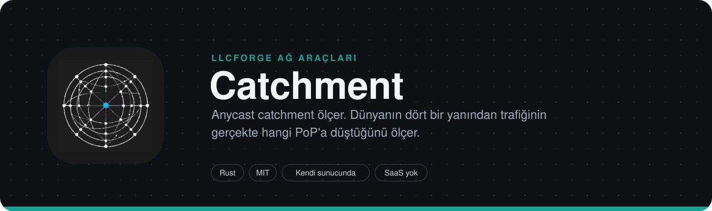
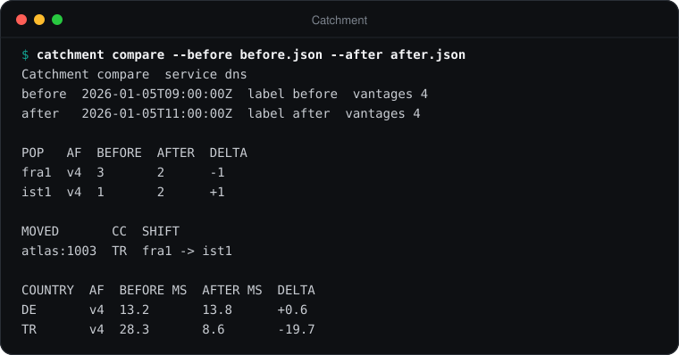
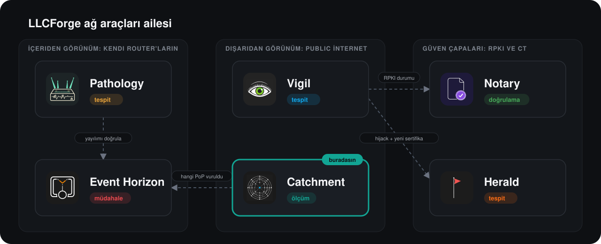

> **LLCForge ağ araçları** — kendi sunucunda, Rust, SaaS yok.
> [Pathology](https://github.com/LLCForge/Pathology) · [Event Horizon](https://github.com/LLCForge/Event-Horizon) · **Catchment** · [Notary](https://github.com/LLCForge/Notary) · [Herald](https://github.com/LLCForge/Herald) · [Vigil](https://github.com/LLCForge/Vigil)

<!-- readme-visuals -->
<p align="center">
  
</p>

<p align="center">Anycast prober. Dünyanın dört bir yanındaki gözlem noktalarından traceroute çalıştırır ve trafiğin gerçekte hangi PoP'a düştüğünü haritalar.</p>

<p align="center">
  <a href="README.md">English</a> · <strong>Türkçe</strong>
</p>

<p align="center">
  <a href="LICENSE"></a>
  
  
</p>

---

## Neden

Anycast'te her kullanıcıya hangi lokasyonun hizmet vereceğine sen değil BGP karar verir. Tek bir upstream değişikliği koca bir kıtayı sessizce yanlış PoP'a kaydırabilir, gecikmeyi ikiye katlayabilir ya da bir saldırıyı tek lokasyona yığabilir. Catchment catchment'ı dışarıdan sürekli ölçer, böylece bu kaymaları oldukları anda görürsün.

## Örnek çıktı

<p align="center">
  
</p>

<sub>`catchment compare --before before.json --after after.json` komutunun (deney modu), dokümantasyon adres aralıkları ve özel ASN'ler kullanan örnek turlar üzerindeki gerçek çıktısı.</sub>

## Özellikler

- **Gözlem noktaları:** RIPE Atlas probe'ları (kendi API anahtarın ve kredilerinle, ülke bazında seçilir), yerel makine ve **karşılıklı TLS (mTLS)** ile ulaşılan, kendi sunucunda çalışan **ajanlar** (`catchment agent`). Her ajan kendi yerel hedef izin listesini uygular. Mevcut Atlas ölçümlerinin sonuçları `catchment fetch` ile yeniden kullanılabilir.
- **PoP tespiti:** DNS CHAOS TXT (`hostname.bind` / `id.server`), **EDNS NSID** (RFC 5001, Atlas'ta da), bir **HTTP yanıt header'ı** (ör. `x-served-by`, yerel makine ve ajanlarda), Atlas ICMP traceroute'unun son hop'u ve **yerel raw-socket traceroute** (ICMP, UDP veya TCP).
- **Eşleştirme:** önce sunucunun kendi kimliği (CHAOS glob'u, NSID glob'u, HTTP header glob'u), ardından son hop ASN'i (RIPEstat), son hop prefix'i ve son hop reverse DNS regex'i. Hiçbir kurala uymayan sonuç `unattributed` olur, asla tahmin edilmez. Son hop sorguları sınırlı paralellikle çalışır ve turlar arasında paylaşılan TTL'li bir önbellek kullanır.
- **Tek config'te birden fazla anycast servisi** (`[[service]]`): her birinin kendi hedefi, PoP kuralları, prefix'i, veri dizini ve metrik etiketi vardır.
- **IPv6 ve dual-stack:** IPv4 veya IPv6 hedefler; `address6` verildiğinde iki aile aynı gözlem noktalarından ölçülür, gözlem noktası bazında karşılaştırılır (aynı PoP mu, RTT farkı) ve ayrı ayrı diff'lenir.
- **Değişim tespiti ve alarmlar:** her tur kaydedilir (atomik yazma, sınırlı saklama) ve bir öncekiyle karşılaştırılır. Kaymalar ülke bazında toplanıp `catchment_shift` alarmı olarak gönderilir; ülke başına medyan RTT son turlardan oluşan bir referansla karşılaştırılır ve `latency_regression` alarmı açılır/kapanır. Alarmlar **llcforge-beacon** üzerinden gider: Telegram, webhook (HMAC), Slack, Discord, Teams, e-posta, PagerDuty, Opsgenie, syslog, stdout; kalıcı kuyruk, tekilleştirme ve susturma (silence).
- **Pathology korelasyonu:** bir kayma olduğunda Catchment, [Pathology](https://github.com/LLCForge/Pathology)'ye servis prefix'i için önceki turdan beri gördüğü BGP path değişikliklerini sorar; sonucu rapora ve ayrı bir takip alarmına ekler (kayma alarmını asla geciktirmez).
- **RIPE Atlas kredi bütçesi:** herhangi bir ölçüm oluşturulmadan önce günlük / aylık limitler (ve isteğe bağlı minimum bakiye) kontrol edilir; en kötü durum maliyeti kalıcı bir defterde ayrılır.
- **Deney modu:** turları etiketle (`--label before`, `--label after`) ve `catchment compare` ile karşılaştır: PoP sayıları, yer değiştiren gözlem noktaları, ülke bazında gecikme.
- **Çıktı:** terminal tablosu (ASN ve dual-stack bölümleriyle), JSON, CSV (formül enjeksiyonuna karşı korumalı) ve **dünya haritalı**, kendi kendine yeten bir **HTML rapor** (paketlenmiş d3-geo + Natural Earth verisi, CDN yok, script'ler CSP hash'leriyle sabitlenmiş). Prometheus metrikleri, `/healthz`, `/readyz`, JSON veya metin loglar.
- **Operasyon:** config yeniden yükleme (SIGHUP, dosya değişikliği, `POST /v1/reload`), `catchment silence add|list|remove`, `catchment service install|uninstall|run` (Windows servisi; systemd / launchd dosyaları paketle gelir), Linux, macOS ve Windows paketleri, container imajı ve Helm chart.

## Ailedeki yeri

Catchment *trafiğin nereye düştüğünü* ölçer; [Pathology](https://github.com/LLCForge/Pathology) ise *nedenini* (hangi upstream path'in değiştiğini) açıklar. Bir saldırı sırasında Catchment, [Event Horizon](https://github.com/LLCForge/Event-Horizon)'dan blackhole istenmeden önce saldırıyı hangi PoP'un karşıladığını gösterir.

<p align="center">
  
</p>

## Kurulum

Linux (glibc ve statik musl, x86_64 / aarch64), macOS (Apple Silicon / Intel) ve Windows (x86_64 / aarch64) arşivleri, cosign ile imzalanmış `SHA256SUMS` ile birlikte her GitHub sürümüne eklenir.

**Linux (deb / rpm / systemd)**

```bash
sudo apt install ./catchment_<sürüm>_amd64.deb      # veya: sudo dnf install ./catchment-<sürüm>.x86_64.rpm
sudoedit /etc/catchment/catchment.toml               # örnek config buraya kurulur
echo 'RIPE_ATLAS_KEY=...' | sudo tee /etc/catchment/catchment.env && sudo chmod 600 /etc/catchment/catchment.env
sudo systemctl enable --now catchment                # `catchment run --config /etc/catchment/catchment.toml` çalıştırır
sudo systemctl reload catchment                      # SIGHUP: config'i yeniden yükler
```

Unit sıkılaştırılmıştır (`DynamicUser`, capability yok, durum `/var/lib/catchment` altında). Yerel raw-socket traceroute için bir drop-in'e (`systemctl edit catchment`) `AmbientCapabilities=CAP_NET_RAW` ve `CapabilityBoundingSet=CAP_NET_RAW` ekle.

**macOS (Homebrew / launchd)**

```bash
brew install llcforge/tap/catchment
sudo cp packaging/launchd/net.llcforge.catchment.plist /Library/LaunchDaemons/   # kaynak ağacından veya sürüm arşivinden
sudo launchctl bootstrap system /Library/LaunchDaemons/net.llcforge.catchment.plist
```

`catchment service install` macOS ve Linux'ta aynı adımları yazdırır.

**Windows (scoop / winget / servis)**

```powershell
scoop install .\catchment.json      # catchment-<sürüm>-package-manifests.tar.gz içindeki manifest (veya kendi bucket'ın)
# veya, manifest winget-pkgs'e yayınlandıktan sonra:
winget install LLCForge.Catchment
# Yerel Windows servisi (yönetici PowerShell'i, açılmış sürüm zip'inde):
.\install-service.ps1 -Config .\catchment.example.toml -EnvFile .\catchment.env
```

Servis hesabı, veri dizini ve gizli bilgilerin yönetimi için [packaging/windows/README.md](packaging/windows/README.md) dosyasına bak. Servis `LocalService` olarak çalışır ve raw socket açamaz: orada `[vantage.local] traceroute = "off"` bırak.

**Docker**

```bash
docker compose up -d        # ./catchment.toml ve ./catchment.env kullanılır, veri isimli bir volume'da
```

İmaj distroless, root olmayan ve salt okunurdur. Container içinde `[metrics] listen = "0.0.0.0:9184"` ayarla. Raw-socket traceroute `cap_add: [NET_RAW]` gerektirir.

**Helm**

```bash
helm install catchment deploy/helm/catchment -f my-values.yaml   # TOML'unu `config:` altına koy
```

Chart, 9184 portunda `/healthz` ve `/readyz` yoklar, alarm kuyruğunu ve turları bir PVC'de tutar ve ServiceMonitor oluşturabilir. Grafana dashboard'u ve Prometheus kuralları: `deploy/grafana/`, `deploy/prometheus/`.

**Kaynaktan**

Gereksinimler: Rust 1.85+ ([rustup.rs](https://rustup.rs)). Sistem kütüphanesi gerekmez (TLS için rustls kullanılır).

```bash
git clone https://github.com/LLCForge/Catchment.git
cd Catchment
cargo build --release
```

## Hızlı başlangıç

> **Durum:** yayın öncesi. Konfigürasyon anahtarları ve CLI parametreleri 1.0'dan önce değişebilir.

```bash
cp catchment.example.toml catchment.toml   # sonra düzenle
./target/release/catchment --config catchment.toml probe
```

Tek servisli minimal `catchment.toml` (adresler dokümantasyon aralıklarından, kendi adreslerinle değiştir). Açıklamalı, çok servisli tam örnek: [catchment.example.toml](catchment.example.toml).

```toml
[target]
address = "192.0.2.53"
qname = "hostname.bind"      # veya "id.server"
nsid = true                  # EDNS NSID de iste
traceroute = true            # Atlas: son hop kurallarını açar

[[pop]]
name = "fra1"
match = { chaos = "fra1.*", nsid = "fra1-*" }

[[pop]]
name = "ist1"
match = { chaos = "ist1.*", last_hop_asn = 64511 }

[[pop]]
name = "nyc1"
match = { last_hop_prefix = "198.51.100.0/24" }

[vantage.local]
country = "TR"

[vantage.ripe_atlas]
api_key_env = "RIPE_ATLAS_KEY"
probes = { countries = ["DE", "TR", "US", "BR", "JP"], per_country = 10 }
budget = { daily_credits = 20000, monthly_credits = 400000 }

[schedule]
interval = "15m"

[metrics]
listen = "127.0.0.1:9184"

[[alerts.sink]]
type = "stdout"
```

Birden fazla servis için `[target]` / `[[pop]]` yerine `[[service]]` tabloları kullan (`name`, `prefix`, `[service.target]`, `[[service.pop]]`). `x` servisinin turları `<storage dir>/x/` altında durur.

Diğer anahtarlar: `[vantage.local] asn / lat / lon / timeout / attempts / traceroute / max_hops / trace_port`, `[[vantage.agent]]`, `[vantage.ripe_atlas] wait / poll / base_url / budget`, `[storage] dir / retain`, `[lookup] dns_resolver / concurrency / cache_ttl`, `[alarms]`, `[alarms.latency]`, `[pathology]`, `[logging]`, `[alerts]`, `[silences]`, `[health]`, `data_dir`. Config açılışta doğrulanır; bilinmeyen anahtarlar reddedilir. Gizli bilgiler (API anahtarları, token'lar) her zaman config'te adı verilen ortam değişkenlerinden okunur, asla dosyadan değil.

## Kullanım

```bash
# Yapılandırılmış tüm gözlem noktaları ve servislerden bir tur; yazdırılır ve kaydedilir
catchment --config catchment.toml probe
catchment --config catchment.toml probe --service dns --format json
catchment --config catchment.toml probe --format csv --html report.html --no-save

# Deney modu: bir değişikliğin öncesini ve sonrasını etiketle, sonra karşılaştır
catchment --config catchment.toml probe --label before
#   ... prepend / community / anons değişikliği ...
catchment --config catchment.toml probe --label after
catchment --config catchment.toml compare --before before --after after
catchment compare --before round-a.json --after round-b.json --format json

# Mevcut RIPE Atlas ölçümlerini eşleştir (ör. bir DNS CHAOS ve bir traceroute id'si)
catchment --config catchment.toml fetch --measurement 2000001 --measurement 2000002

# Son kaydedilen turu veya belirli bir tur dosyasını yeniden göster (dünya haritasıyla)
catchment --config catchment.toml show --service dns --html report.html
catchment show --round catchment-data/round-00000001794587903000.json --format csv

# Daemon: her [schedule] aralığında tur, alarmlar, /metrics, /healthz, /readyz
catchment --config catchment.toml run --html report.html

# Kendi sunucunda gözlem noktası (başka bir makinede)
catchment --config catchment-agent.toml agent

# Susturma ve servis yönetimi
catchment --config catchment.toml silence add --resource 'dns/DE/*' --duration 2h -m "fiber çalışması"
catchment --config catchment.toml silence list
catchment --config catchment.toml service install      # Windows servisi; diğer sistemlerde systemd/launchd adımlarını yazdırır
```

Genel parametreler: `--config`, `--log-format text|json`, `--log-level <seviye veya filtre>` (`[logging]` ayarını ezer; `RUST_LOG` da çalışır). Loglar stderr'e, veri stdout'a gider.

### Alarmlar

| Tür | Ne zaman | Kaynak / id |
|---|---|---|
| `catchment_shift` | bir ülkeden `shift_min_vantages` veya daha fazla gözlem noktası aynı PoP'lar arasında yer değiştirdi | `<servis>/<ÜLKE>/<v4\|v6>`, id `from->to` içerir |
| `catchment_shift_paths` | Pathology servis prefix'i için path değişiklikleri bildirdi (bilgi) | `<servis>/<prefix>` |
| `latency_regression` | bir ülkenin medyan RTT'si referans × `ratio` değerini aştı ve referanstan en az `min_increase_ms` yüksek; düzelince kapanır | `<servis>/<ÜLKE>/<v4\|v6>` |
| `atlas_budget` | bir kredi limiti veya `min_balance` turun Atlas kısmını durdurdu | `ripe-atlas` |

Sink'ler resource glob'larıyla servis bazında yönlendirilebilir, ör. `resources = ["dns/*"]`.

### Ajanlar (karşılıklı TLS)

Ajan `POST /v1/probe` uç noktasını TLS üzerinden sunar ve yalnızca sertifikası yapılandırılmış CA tarafından imzalanmış istemcileri kabul eder. Yalnızca kendi `allowed_targets` listesindeki adresleri ölçer; böylece çalınmış bir controller sertifikası ajanları bir tarayıcıya çeviremez. OpenSSL ile örnek PKI (ayrı bir CA kullan):

```bash
openssl req -x509 -newkey ec -pkeyopt ec_paramgen_curve:P-256 -nodes -days 825 -subj "/CN=catchment-ca" -keyout ca-key.pem -out ca.pem
openssl req -newkey ec -pkeyopt ec_paramgen_curve:P-256 -nodes -subj "/CN=agent-ams" -keyout agent-key.pem -out agent.csr
printf "subjectAltName=DNS:agent-ams.example.net\nextendedKeyUsage=serverAuth\n" > agent.ext
openssl x509 -req -in agent.csr -CA ca.pem -CAkey ca-key.pem -CAcreateserial -days 825 -extfile agent.ext -out agent.pem
openssl req -newkey ec -pkeyopt ec_paramgen_curve:P-256 -nodes -subj "/CN=controller" -keyout controller-key.pem -out controller.csr
printf "extendedKeyUsage=clientAuth\n" > controller.ext
openssl x509 -req -in controller.csr -CA ca.pem -CAkey ca-key.pem -CAcreateserial -days 825 -extfile controller.ext -out controller.pem
```

Ajan tarafı: [catchment-agent.example.toml](catchment-agent.example.toml). Controller tarafı: her ajan için `url`, `ca`, `cert`, `key` içeren bir `[[vantage.agent]]`.

### Yerel traceroute yetkileri

`[vantage.local] traceroute = "icmp" | "udp" | "tcp"` (ajanlarda `allow_traceroute`) raw socket kullanır:

| İşletim sistemi | Gereksinim |
|---|---|
| Linux | `CAP_NET_RAW` (`setcap cap_net_raw+ep`, systemd `AmbientCapabilities=CAP_NET_RAW`, container `NET_RAW`) veya root |
| macOS | root |
| Windows | yükseltilmiş süreç (Yönetici); Windows Güvenlik Duvarı'nda gelen ICMPv4/ICMPv6 *Time Exceeded* mesajlarına izin verilmeli |

Yetki yoksa traceroute anlaşılır bir `trace_error` ve uyarı ile atlanır; gözlem noktasının CHAOS / NSID / HTTP sonucu korunur. Hiçbir hop yanıt vermezse `trace_error` bunu belirtir (genellikle ICMP'yi düşüren bir güvenlik duvarı).

### Metrikler

`[metrics] listen` ile çalışan `catchment run`; `/metrics`, `/healthz`, `/readyz` (token'ları yapılandırıldığında `/v1/silences` ve `POST /v1/reload`) sunar:
`catchment_rounds_total{service,outcome}`, `catchment_shifts_total{service}`, `catchment_round_shifts{service}`, `catchment_vantages{service,pop,country,family}`, `catchment_country_rtt_median_ms{service,country,family}`, `catchment_latency_regressions{service}`, `catchment_dual_stack_pop_mismatch{service}`, `catchment_last_round_timestamp_seconds{service}`, `catchment_atlas_credits_spent{period}`, `catchment_atlas_credits_cap{period}`, `catchment_enrich_cache_entries` ve `llcforge_beacon_*` teslimat metrikleri.

RIPE Atlas notları: her `probe` turu tek seferlik ölçümler oluşturur ve kredi harcar (tek seferlik DNS sonuç başına 20, tek seferlik traceroute 60 kredi). Bütçe, rate-limit (HTTP 429) ve kredi hataları o turun Atlas kısmını bir uyarıyla atlar; yerel ve ajan gözlem noktaları raporlamaya devam eder. Herkese açık ölçüm sonuçları API anahtarı olmadan da çekilebilir.

## Platformlar

Windows, macOS ve Linux (CI üçünde de çalışır). Raw-socket kodu `socket2` arkasındadır ve yukarıda anlatıldığı gibi çalışma anında kontrollü biçimde devre dışı kalır; servis entegrasyonu dışında (Windows SCM; Unix'te systemd / launchd dosyaları) işletim sistemine özgü başka bir şey yoktur.

## Yol haritası

Doğrulanabildiği ölçüde uygulandı; bilinen sınırlar:

- HTTP header ile tespit RIPE Atlas probe'larından yapılamaz (Atlas HTTP ölçümlerine yalnızca anchor'lara doğru izin verir); yerel makineyi veya ajanları kullan.
- Yerel traceroute hop başına tek probe gönderir ve akışı hop'lar arasında sabit tutmaz (Paris-traceroute değil), alıntılanan paketlerdeki IPv6 uzantı başlıkları ayrıştırılmaz ve Linux'un yetkisiz ICMP datagram soketleri (`ping_group_range`) kullanılmaz. Canlı olarak Windows'ta denendi; Linux ve macOS yolları yalnızca birim testleri ve CI derlemeleriyle doğrulanıyor.
- `catchment agent` ön planda çalışır; servis dosyaları yalnızca `catchment run` için gelir (ajanları kendi systemd/launchd/Windows servis sarmalayıcınla çalıştır).
- Atlas harcaması oluşturma anında en kötü durum olarak ayrılır, sonradan gerçek maliyetle eşleştirilmez.
- Açık gecikme gerilemeleri bellekte izlenir: yeniden başlatmadan sonra tekrar açılır (id ile tekilleştirilir) ve daemon kapalıyken düzelen bir gerileme kapatılmaz.
- Harita koordinatı olan gözlem noktalarını çizer (Atlas probe'ları, yapılandırılmış `lat`/`lon`); ülke bazlı choropleth yok.
- Uzun süreli periyodik Atlas ölçümlerinin `fetch` ile çekilmesi bir zaman penceresi gerektirir (Atlas en fazla 7 günlük sonuç döndürür); yalnızca tek seferlik veya kısa ölçümler çalışır.
- Metrik dinleyici adresinin değişmesi yeniden başlatma gerektirir (geri kalan her şey yeniden yüklenir).

## Nasıl çalışır

Bileşenler, veri akışı, güven sınırları ve hata senaryoları için [ARCHITECTURE.md](ARCHITECTURE.md) dosyasına bak.

## İlgili araçlar

- [Pathology](https://github.com/LLCForge/Pathology): Kendi router'ların ve BMP beslemelerin için BGP rota izleyici. Prefix'lerinin normalde kullandığı AS path'leri ve origin'leri öğrenir, en küçük sapmada alarm verir.
- [Event Horizon](https://github.com/LLCForge/Event-Horizon): Rust ile otomatik RTBH. DDoS tespit ettiğinde kurban prefix'i blackhole olarak anons eder ve BGP community'sini upstream'e gönderir.
- [Notary](https://github.com/LLCForge/Notary): RPKI Route Origin Validation denetleyicisi. Prefix'lerinin RPKI-valid olup olmadığını söyler ve üçüncü taraf AS'leri milisaniyeler içinde izler.

## Katkı

Issue ve pull request'ler memnuniyetle karşılanır. Önce [CONTRIBUTING.md](CONTRIBUTING.md) ve [Davranış Kuralları](CODE_OF_CONDUCT.md) dosyalarını oku. Bir güvenlik açığı mı buldun? Public issue **açma**; [SECURITY.md](SECURITY.md) adımlarını izle.

## Lisans

Catchment, [MIT Lisansı](LICENSE) ile yayınlanan özgür ve açık kaynak bir yazılımdır. Atıflar (paketlenmiş harita kütüphaneleri ve verisi dahil) için [NOTICE](NOTICE) dosyasına bak.
